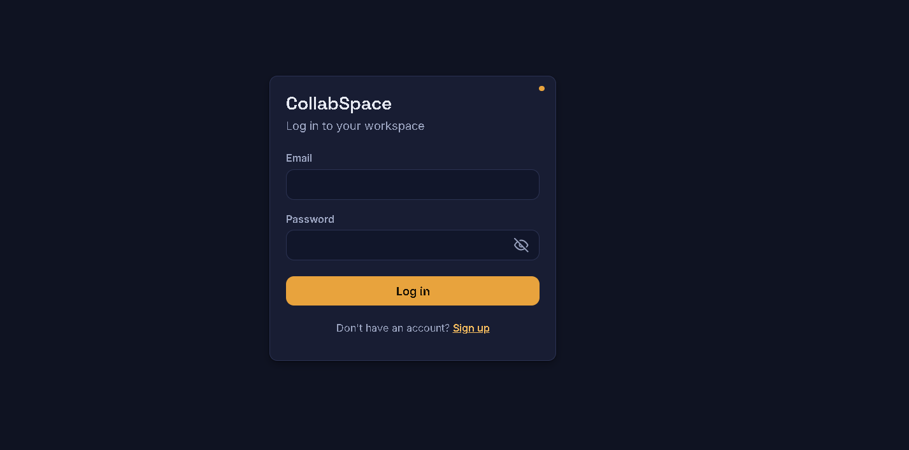
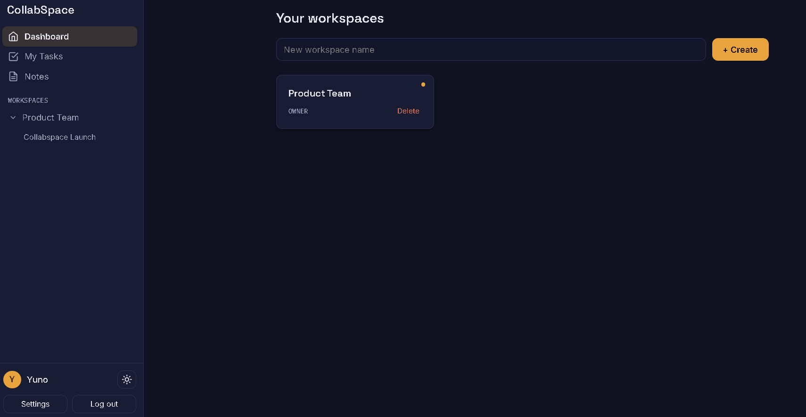
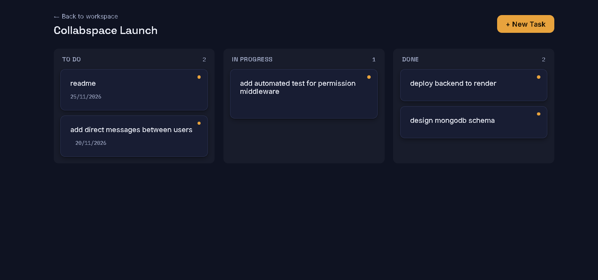

# CollabSpace

Live demo: https://collabspace-psi-roan.vercel.app

The backend runs on a free hosting tier that goes to sleep when nobody is using it, so the very first load after a quiet period can take up to a minute. After that it responds normally.

CollabSpace is a team collaboration app that combines a Trello-style Kanban board with Slack-style real-time chat, built entirely on the MERN stack. I built it to go deeper into full-stack development than my earlier projects allowed — specifically to work with a real backend and database (as opposed to a mock API), JWT-based authentication, role-based permissions, and real-time features with Socket.io.

The idea: teams need somewhere to organize tasks and somewhere to talk about them, and those two things usually live in separate apps. CollabSpace puts both in one place, scoped per workspace.

## Screenshots







## What it does

- Sign up and log in with JWT-based authentication (passwords hashed with bcrypt)
- Create workspaces and invite teammates by email, with three roles: owner, admin, and member
- Create projects within a workspace, each with its own Kanban board
- Create tasks, assign them to teammates, set due dates, and drag them between To Do, In Progress, and Done
- Real-time group chat per workspace, built with Socket.io — messages appear instantly for everyone in the room, no refreshing
- Role-based access control throughout: only owners can delete a workspace, only owners/admins can invite members, and every workspace-scoped action checks membership before allowing it
- Unread message badges on each workspace, in the dashboard and in the sidebar. They update live while you are on another page.
- A sidebar for moving around: your workspaces and their projects, plus links to the pages below.
- My Tasks: every open task assigned to you across all your workspaces, grouped as overdue, due this week, later and no due date.
- Private notes with search, for ideas and reminders. Only the person who wrote a note can see it.
- Light and dark themes, remembered between visits.
- Access control throughout. Only owners can delete a workspace, only owners and admins can invite or remove members, and every workspace action checks membership first.
## Tech stack

**Frontend:** React 19, Vite, React Router, Axios, Socket.io-client, @dnd-kit for drag-and-drop

**Backend:** Node.js, Express, MongoDB with Mongoose, Socket.io, JWT, bcrypt

## How it's structured

The data model follows a fairly standard hierarchy: a Workspace contains Projects, and each Project contains Tasks. Membership is handled through a separate `WorkspaceMember` collection rather than embedding a members array directly on the Workspace — this made it easier to query "which workspaces does this user belong to" without scanning every workspace document, and it's the kind of tradeoff (normalized vs. embedded) that felt worth learning properly rather than guessing at.

On the backend, routes, controllers, and middleware are kept in separate files. Access control is layered as middleware — for example, hitting a task endpoint runs through `protect` (are you logged in), then a chain that traces task → project → workspace to confirm you're actually a member before any data is returned or changed. Socket.io connections go through the same kind of check before a user can join a workspace's chat room or send a message, so the real-time side isn't just trusting whatever the frontend claims.

```
collabspace-backend/
├── config/         MongoDB connection
├── controllers/    Route logic
├── middleware/      Auth checks, membership/role checks
├── models/         Mongoose schemas
├── routes/          Route definitions
├── sockets/         Socket.io event handlers
└── server.js

collabspace-frontend/
├── src/
│   ├── api/          Functions that call the backend
│   ├── components/   Reusable UI pieces
│   ├── context/       Auth state
│   ├── pages/         Full pages
│   └── socket.js       Socket.io client setup
```

## Running it locally

You'll need Node.js and a MongoDB Atlas connection string (or a local MongoDB instance).

**Backend**

```
cd collabspace-backend
npm install
cp .env.example .env
```

Fill in `.env` with your own values:

```
PORT=5000
MONGO_URI=your_mongodb_connection_string
JWT_SECRET=any_long_random_string
```

```
npm run dev
```

The API will run on `http://localhost:5000`. Visit `/api/health` to confirm it's up.

**Frontend**

```
cd collabspace-frontend
npm install
cp .env.example .env
npm run dev
```

By default the frontend expects the backend at `http://localhost:5000` — change `VITE_API_URL` in `.env` if yours is somewhere else.

Deployment

The frontend is on Vercel with frontend as the root directory and VITE_API_URL pointing at the backend. A vercel.json rewrite sends every path to index.html, so refreshing on a page like /dashboard does not 404. The backend is on Render with backend as the root directory, npm start as the start command, and MONGO_URI, JWT_SECRET and CLIENT_URL set as environment variables. CORS, for both the REST API and Socket.io, only allows the address in CLIENT_URL.

## What I'd add next

- Direct messages between individual users, separate from the workspace-wide group chat
- A notifications system for task assignments and mentions (the data model has room for it, the backend logic isn't built yet)
- Pagination for chat history instead of just loading the most recent 100 messages
- Removing members from a workspace, and letting members leave on their own

